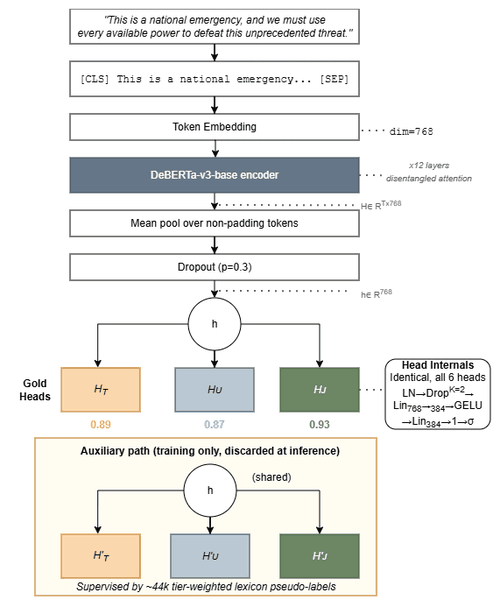
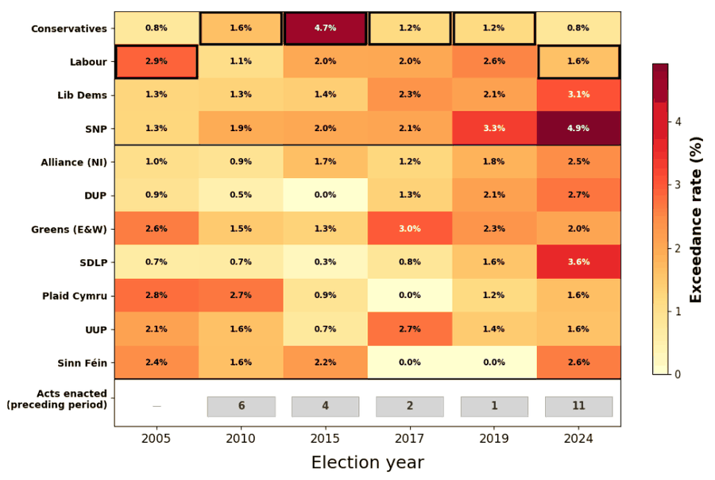
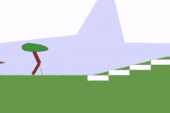
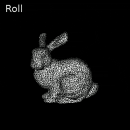
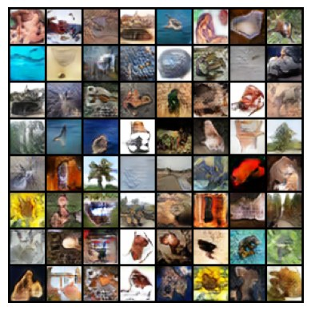
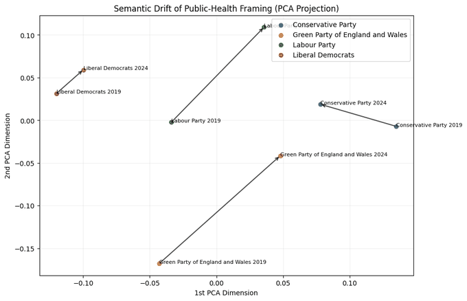
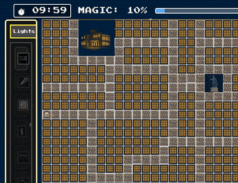
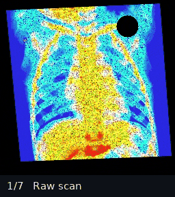
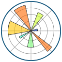

<picture>
  <source media="(prefers-color-scheme: dark)" srcset="assets/header-dark.svg">
  
</picture>

  
  
  

<b><i>Abstract.</i></b> I am a First Class Computer Science graduate from Durham University, joining Accenture as a Technical Analyst. My academic work centres on computational methods for political language, using transformer models to quantify rhetoric at a scale that qualitative analysis cannot reach. Alongside this, I have built learning agents, generative models and real-time tracking systems under deliberately tight constraints. Every figure on this page is taken directly from that work.

<b><i>Index Terms.</i></b> Natural language processing, transformers, reinforcement learning, generative modelling, sensor fusion, data engineering

## 1&nbsp;&nbsp;Background

My route into industry ran through a year-long placement at Procter &amp; Gamble, where I worked as an IT project manager on internal data platforms. The role combined directing outsourced developers with hands-on delivery, including an ETL redesign, a Power BI to Databricks migration and application deployment on Azure App Service.

Alongside my degree, I have spent over seven years tutoring GCSE, A-level and IB Maths and Computer Science, which has shaped how I communicate technical work. I also evaluate large language model outputs on tool-calling and code-review tasks, and I am currently building a fully local, modular AI assistant on self-hosted hardware. Outside of computing I skydive, recording each jump in a [logbook app](https://github.com/JBourton/Skydiving-Logbook-App) I built for the purpose.

## 2&nbsp;&nbsp;Selected Work

### 2.1&nbsp;&nbsp;Dissertation &middot; [Securitising the Ballot](https://github.com/JBourton/Securitising-the-Ballot-Computational-Modelling-of-Securitising-Rhetoric-in-UK-Party-Manifestos)

*Computational modelling of securitising rhetoric in UK party manifestos*

My dissertation operationalises securitisation theory as a continuous, multi-dimensional regression problem. A shared DeBERTa-v3 encoder feeds three regression heads that score each manifesto sentence for threat, urgency and justification of extraordinary power. Because gold labels are costly to produce, auxiliary heads also learn from roughly 44,000 lexicon-derived pseudo-labels, supplementing 1,500 sentences that I annotated by hand.

The selected model reached a macro Spearman correlation of 0.524 and a macro QWK of 0.623 on held-out data, with 5-fold cross-validation confirming generalisation at 0.487 ± 0.016. Applied across six general elections from 2005 to 2024, it shows that securitising rhetoric diverged between parties. Threat became a shared baseline among the largest parties, urgency distinguished the governing party, and that party legislated most when its own securitising rhetoric was weakest.

<table>
  <tr>
    <td width="36%" align="center" valign="top">
       
      <i>Fig. 1. Multi-head regression architecture, with auxiliary heads used only in training.</i>
    </td>
    <td width="64%" align="center" valign="top">
       
      <i>Fig. 2. Share of each manifesto's sentences above the composite securitisation threshold, with governing parties outlined.</i>
    </td>
  </tr>
</table>

### 2.2&nbsp;&nbsp;Coursework and Projects

<table>
  <tr>
    <td width="50%" align="center" valign="top">
       
      <i>Fig. 3. Hardcore run clearing stairs, stumps and pits.</i>
      
<b><a href="https://github.com/JBourton/The-Walking-Dead-Ends-RL-Locomotion">The Walking Dead-Ends</a></b> YEAR 3 &middot; REINFORCEMENT LEARNING A TD3 agent that learns bipedal locomotion from scratch, extended for hardcore terrain with n-step returns, action smoothing and an episode-length curriculum. It averages 226 reward over its final 100 easy-mode episodes, whilst hardcore runs reach a median of 207 across the final 500.

      
PyTorch &middot; Gymnasium &middot; NumPy

    </td>
    <td width="50%" align="center" valign="top">
       
      <i>Fig. 4. Roll, pitch and yaw under the complementary filter.</i>
      
<b><a href="https://github.com/JBourton/vr-spatial-rotation-system">VR Spatial Rotation System</a></b> YEAR 3 &middot; VIRTUAL REALITY Head tracking from raw IMU data, fusing gyroscope, accelerometer and magnetometer readings through quaternion complementary filters to drive a software-rendered Stanford bunny. Accelerometer fusion reduced roll drift at rest from 18.6° to 2.8° RMS.

      
NumPy &middot; OpenCV &middot; pandas

    </td>
  </tr>
  <tr>
    <td width="50%" align="center" valign="top">
       
      <i>Fig. 5. Uncurated class-conditional samples from the GAN.</i>
      
<b><a href="https://github.com/JBourton/Efficient-CIAFR-100-Deep-Learning">Efficient CIFAR-100 Modelling</a></b> YEAR 3 &middot; DEEP LEARNING A MobileNet-inspired classifier that reaches 62.9% test accuracy within 100k parameters, paired with a projection-based conditional GAN that achieves an FID of 38.0 within 1M parameters. Both were built incrementally, retaining each change only where it measurably helped.

      
PyTorch &middot; clean-fid &middot; LPIPS

    </td>
    <td width="50%" align="center" valign="top">
       
      <i>Fig. 6. Semantic drift in each party's public-health framing, projected with PCA.</i>
      
<b><a href="https://github.com/JBourton/An-NLP-Analysis-of-Parliamentary-Attitudes-to-Public-Health-Pre-and-Post-Pandemic">Public Health Rhetoric Before and After COVID-19</a></b> YEAR 3 &middot; NATURAL LANGUAGE PROCESSING Measures how four UK parties reframed public health between their 2019 and 2024 manifestos, combining bootstrapped VADER sentiment, SBERT semantic drift and POS-bigram stylistic analysis. Labour diverged most strongly, whilst the other three parties converged semantically.

      
sentence-transformers &middot; spaCy &middot; scikit-learn

    </td>
  </tr>
  <tr>
    <td width="50%" align="center" valign="top">
       
      <i>Fig. 7. Placing light installations as visitors arrive, at roughly 4× speed.</i>
      
<b><a href="https://github.com/JBourton/Lumiere-Game">Lumiere Festival Planner</a></b> YEAR 3 &middot; GAME DEVELOPMENT A browser-based management game set in Durham, in which autonomous visitors navigate using congestion-aware A* pathfinding. The player balances magic, staffing and crowd frustration through interlocking feedback loops, supported by a live congestion heatmap and accessibility features.

      
JavaScript &middot; Plotly &middot; HTML/CSS

    </td>
    <td width="50%" align="center" valign="top">
       
      <i>Fig. 8. Each pipeline stage applied to a single scan.</i>
      
<b><a href="https://github.com/JBourton/Image-Cleaning-For-Pneumonia-Diagnosis">Image Cleaning for Pneumonia Diagnosis</a></b> YEAR 2 &middot; COMPUTER VISION A classical computer vision pipeline that repairs noisy, warped and occluded chest X-rays before classification. Across 100 scans, cleaning raised a pre-trained classifier's accuracy from 55% to 93%.

      
OpenCV &middot; NumPy

    </td>
  </tr>
</table>

## 3&nbsp;&nbsp;Toolkit

<table>
  <tr>
    <td><b>Languages</b></td>
    <td align="center" width="76"> Python</td>
    <td align="center" width="76"> JavaScript</td>
    <td align="center" width="76"> TypeScript</td>
    <td align="center" width="76"> SQL</td>
    <td align="center" width="76"> C</td>
    <td align="center" width="76"> HTML5</td>
    <td align="center" width="76"> CSS3</td>
    <td align="center" width="76"> LaTeX</td>
  </tr>
  <tr>
    <td><b>Machine learning</b></td>
    <td align="center"> PyTorch</td>
    <td align="center"> Hugging Face</td>
    <td align="center"> scikit-learn</td>
    <td align="center"> spaCy</td>
    <td align="center"> OpenCV</td>
    <td align="center"> Gymnasium</td>
  </tr>
  <tr>
    <td><b>Data and statistics</b></td>
    <td align="center"> pandas</td>
    <td align="center"> NumPy</td>
    <td align="center"> SciPy</td>
    <td align="center"> PySAL</td>
    <td align="center"> Matplotlib</td>
    <td align="center"> seaborn</td>
    <td align="center"> Plotly</td>
  </tr>
  <tr>
    <td><b>Cloud and DevOps</b></td>
    <td align="center"> Azure</td>
    <td align="center"> App Service</td>
    <td align="center"> Docker</td>
    <td align="center"> Actions</td>
    <td align="center"> Git</td>
  </tr>
  <tr>
    <td><b>Analytics and tooling</b></td>
    <td align="center"> Databricks</td>
    <td align="center"> Power BI</td>
    <td align="center"> Jupyter</td>
    <td align="center"> Colab</td>
    <td align="center"> VS Code</td>
  </tr>
</table>

## 4&nbsp;&nbsp;GitHub Activity

  <picture>
    <source media="(prefers-color-scheme: dark)" srcset="https://github-readme-stats.vercel.app/api?username=JBourton&show_icons=true&hide_rank=true&hide=contribs&include_all_commits=true&hide_border=true&bg_color=00000000&title_color=C9A3D4&icon_color=C9A3D4&text_color=C9D1D9">
    
  </picture>
  <picture>
    <source media="(prefers-color-scheme: dark)" srcset="https://github-readme-stats.vercel.app/api/top-langs/?username=JBourton&layout=compact&langs_count=8&hide_border=true&bg_color=00000000&title_color=C9A3D4&text_color=C9D1D9">
    
  </picture>

